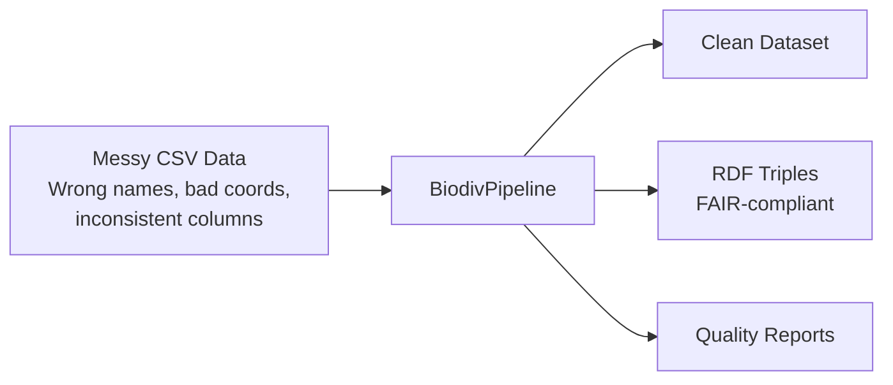
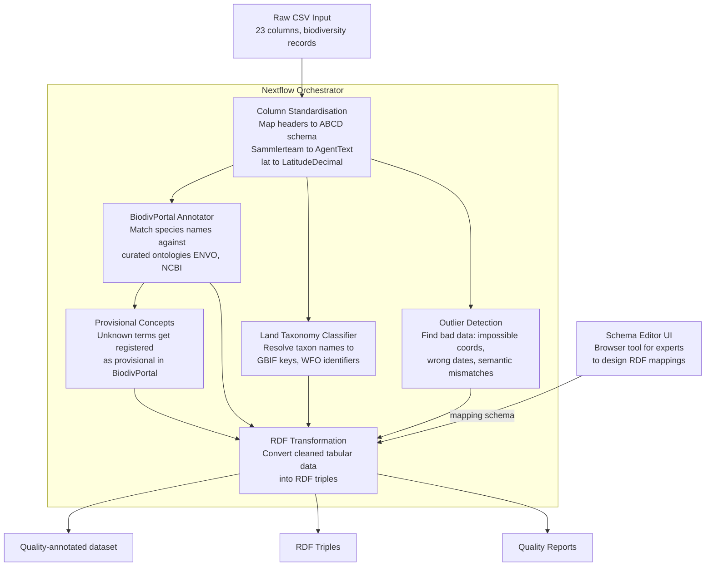

# BiodivPipeline

A modular nf-core/Nextflow pipeline that transforms raw biodiversity CSV records into FAIR-compliant RDF triples with automated quality checks, taxonomy resolution, and ontology annotation.

**Built for:** [NFDI4Biodiversity](https://www.nfdi4biodiversity.org/) / InfAI / BGBM
**Framework:** [nf-core](https://nf-co.re) template v4.0.2
**Dataset:** 109,297 herbarium specimen records from Botanischer Garten und Botanisches Museum Berlin (BGBM)

## What it does



## How it works

The pipeline orchestrates 7 processing modules via Nextflow. Modules run in parallel where possible.



## Quick start

**Prerequisites:** Java 11+, [Nextflow](https://www.nextflow.io/) >= 24.x, [Docker](https://www.docker.com/)

```bash
# Clone
git clone git@github.com:biodivportal/BiodivPipeline.git
cd BiodivPipeline

# Unzip dataset (already in repo)
unzip Belege_aus_D.zip

# Run with test data (109 records)
nextflow run main.nf -profile test,docker --outdir results

# Run with full dataset
nextflow run main.nf -profile docker \
    --input Belege_aus_D.csv \
    --outdir results
```

### Parameters

| Parameter          | Required | Description                                                                                 |
| ------------------ | -------- | ------------------------------------------------------------------------------------------- |
| `--input`          | Yes      | Path to input CSV file (biodiversity records)                                               |
| `--mapping_schema` | No       | Path to RDF mapping schema (JSON-LD or Turtle). Defaults to `assets/default_mapping.jsonld` |
| `--outdir`         | Yes      | Path to output directory                                                                    |
| `-profile`         | Yes      | Execution profile: `docker`, `singularity`, `test`                                          |

## Output

Results are written to `--outdir` with the following structure:

```
results/
├── annotation/                  # WP2: BiodivPortal annotation results
│   ├── annotated.jsonld
│   └── unresolved_terms.csv
├── column_standardisation/      # WP6: ABCD column mapping
│   ├── standardised.csv
│   └── column_mapping.json
├── taxonomy/                    # WP3: Resolved taxonomy
│   └── taxonomy_resolved.csv
├── quality/                     # WP4: Outlier detection
│   ├── quality_report.json
│   └── flagged_records.csv
├── provisional_concepts/        # WP5: Registered provisional terms
│   └── provisional_concepts.json
├── rdf/                         # WP7: RDF transformation output
│   ├── output.ttl
│   ├── output.jsonld
│   └── rdf_report.json
├── reports/                     # Aggregated pipeline summary
│   └── pipeline_summary.json
└── pipeline_info/               # Nextflow execution metadata
    ├── execution_report_*.html
    ├── execution_timeline_*.html
    ├── execution_trace_*.txt
    ├── pipeline_dag_*.html
    ├── params_*.json
    └── biodivpipeline_software_versions.yml
```

For details on each output file, see [docs/output.md](docs/output.md).

## Project structure

```
BiodivPipeline/
├── main.nf                      # Pipeline entry point
├── workflows/biodivpipeline.nf  # Main workflow DAG
├── modules/local/               # Pipeline modules (one per work package)
│   ├── column_standardise/      # WP6: CSV headers → ABCD terms
│   ├── biodiv_annotate/         # WP2: BiodivPortal annotation
│   ├── taxonomy_classify/       # WP3: Taxon → GBIF/WFO IDs
│   ├── outlier_detect/          # WP4: Statistical + LLM quality checks
│   ├── provisional_concepts/    # WP5: Register unknown terms
│   ├── rdf_transform/           # WP7: Tabular → RDF triples
│   └── collect_reports/         # Aggregate reports
├── modules/stubs/               # Mock FastAPI service for testing
├── conf/                        # Nextflow config profiles
├── assets/                      # Static files (default mapping schema)
├── test_data/                   # 109-record sample dataset
├── subworkflows/                # nf-core shared utilities
└── docs/                        # Documentation
```

## Documentation

- [Usage guide](docs/usage.md) — detailed usage, parameters, and data flow
- [Output reference](docs/output.md) — description of every output file
- [Contributing](docs/CONTRIBUTING.md) — git conventions, branch model, module interface

## Credits

**Pipeline development:** SPST Team, FU Berlin, AG Corporate Semantic Web (SS 2026)
**Customer:** Naouel Karam (karam@infai.org), Jan Fillies (fillies@infai.org) — InfAI
**Data provider:** Botanischer Garten und Botanisches Museum Berlin (BGBM)
**Coordinator:** Prof. Dr. Adrian Paschke

Built using the [nf-core](https://nf-co.re) framework. See [`CITATIONS.md`](CITATIONS.md) for a full list of tools and references.

> **The nf-core framework for community-curated bioinformatics pipelines.**
> Philip Ewels, Alexander Peltzer, Sven Fillinger, Harshil Patel, Johannes Alneberg, Andreas Wilm, Maxime Ulysse Garcia, Paolo Di Tommaso & Sven Nahnsen.
> _Nat Biotechnol._ 2020 Feb 13. doi: [10.1038/s41587-020-0439-x](https://dx.doi.org/10.1038/s41587-020-0439-x).
