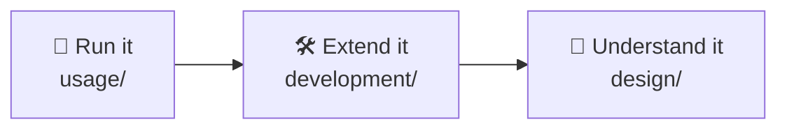

# BiodivPipeline Documentation

Start here. Docs are grouped by what you're trying to do. For the big picture,
see the [pipeline dataflow diagram](design/flow_diagram.md).

## Usage — run the pipeline

- [Usage](usage/usage.md) — install, secrets, profiles, and running the pipeline
- [Output](usage/output.md) — what each file in the results folder is

## Development — build & contribute

- [Contributing](development/CONTRIBUTING.md) — branch model, PRs, conventions
- [Module integration guide](development/module-integration-guide.md) — add your module to the pipeline
- [Testing guidelines](development/test_guidelines.md) — the tests each module must provide
- [Linting](development/linting_guidelines.md) — nf-core lint configuration

## Design — how & why

- [Dataflow](design/flow_diagram.md) — how data moves through the pipeline (diagram)
- [Resource monitoring](design/resource_monitoring.md) — runtime & resource metrics (decision record)
- [WP1 hardening plan](design/wp1-hardening-plan.md) — proposed follow-up work (RFC)
