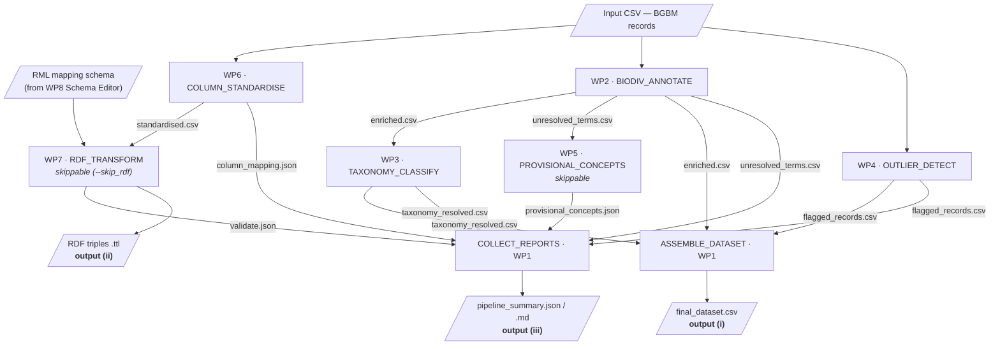

# BiodivPipeline — Dataflow

A quick view of how data moves through the pipeline. Reflects the wiring in
[`workflows/biodivpipeline.nf`](../../workflows/biodivpipeline.nf).

## How to read it

- The raw CSV fans out to **three independent branches**: WP6 (column standardisation),
  WP2 (annotation), WP4 (outlier detection).
- WP2's `enriched.csv` feeds **WP3 taxonomy**; its `unresolved_terms.csv` feeds
  **WP5 provisional concepts**.
- **Green — WP1 modules:** `ASSEMBLE_DATASET` joins annotation + taxonomy + quality flags
  into the unified **output (i)**; `COLLECT_REPORTS` aggregates every module's signal into
  **output (iii)**.
- **Orange dashed — skippable:** WP5 (needs an LLM key) and WP7 RDF (needs a matching RML
  mapping) → **output (ii)**.

## The three deliverables (Lastenheft Requirement 1)

| # | Output | Produced by |
| - | ------ | ----------- |
| i | `final_dataset/final_dataset.csv` — quality-annotated + taxonomically resolved dataset | `ASSEMBLE_DATASET` |
| ii | `rdf/<id>.ttl` — RDF triples from the expert mapping | `RDF_TRANSFORM` (skippable) |
| iii | `reports/pipeline_summary.{json,md}` — per-step quality reports | `COLLECT_REPORTS` |
