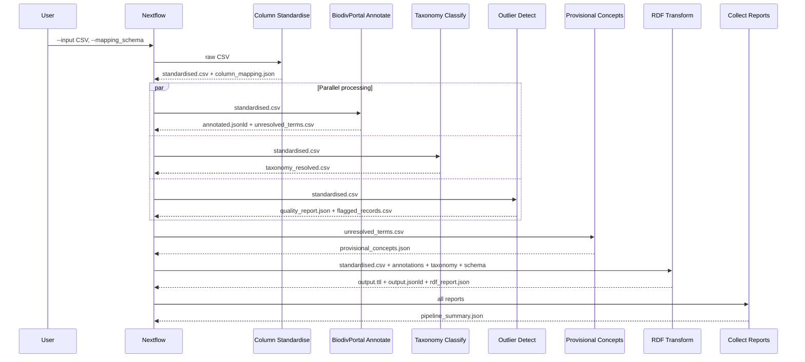

# BiodivPipeline: Usage

## Prerequisites

| Requirement                          | Minimum | Tested          |
| ------------------------------------ | ------- | --------------- |
| Java                                 | 11+     | OpenJDK 21.0.11 |
| [Nextflow](https://www.nextflow.io/) | >= 24.x | 26.04.0         |
| [Docker](https://www.docker.com/)    | >= 20.x | 29.3.0          |

## Input data

The pipeline expects a CSV file with biodiversity specimen records. The input CSV must have a header row. Column names do not need to follow a standard — the Column Standardisation module maps them to ABCD schema terms.

The included test dataset (`test_data/sample.csv`) contains 109 records with 23 columns sampled from the BGBM Belege_aus_D dataset:

```
HerbariumID, Bild, DB, Family, FullNameCache, Anmerkungen, Sammlerteam,
Sammelnummer, CollectionDateBegin, CollectionDateEnd, Country, Locality,
TitelEtikett, Expeditionsangabe, ShowOnMap, Latitude, Longitude,
FundortUNdOeko, NameCache, Genus, Identifier, Barcode, StableURI
```

The full dataset (`Belege_aus_D.csv`, 109,297 records) is distributed as a zip archive in the repository.

## Running the pipeline

### Quick test run

```bash
nextflow run main.nf -profile test,docker --outdir results
```

The `test` profile points to `test_data/sample.csv` and `assets/default_mapping.jsonld` so no other parameters are needed.

### Full dataset run

```bash
# Unzip dataset if not already done
unzip Belege_aus_D.zip

nextflow run main.nf -profile docker \
    --input Belege_aus_D.csv \
    --outdir results
```

### Custom mapping schema

```bash
nextflow run main.nf -profile docker \
    --input data/my_records.csv \
    --mapping_schema schemas/my_mapping.jsonld \
    --outdir results
```

## Parameters

| Parameter          | Required | Default                         | Description                                                                        |
| ------------------ | -------- | ------------------------------- | ---------------------------------------------------------------------------------- |
| `--input`          | Yes      | —                               | Path to input CSV file containing biodiversity records                             |
| `--mapping_schema` | No       | `assets/default_mapping.jsonld` | Path to RDF mapping schema (JSON-LD or Turtle format)                              |
| `--outdir`         | Yes      | —                               | Directory for pipeline output files                                                |
| `-profile`         | Yes      | —                               | Execution profile: `docker`, `singularity`, `test`, or comma-separated combination |

Parameters can also be supplied via a YAML file:

```bash
nextflow run main.nf -profile docker -params-file params.yaml
```

```yaml
# params.yaml
input: "./Belege_aus_D.csv"
mapping_schema: "./assets/default_mapping.jsonld"
outdir: "./results"
```

## Pipeline data flow



## Execution profiles

Multiple profiles can be combined: `-profile test,docker`. They load in order, so later profiles override earlier ones.

| Profile       | Description                                                        |
| ------------- | ------------------------------------------------------------------ |
| `test`        | Uses `test_data/sample.csv` (109 records). No other params needed. |
| `docker`      | Run module containers with Docker                                  |
| `singularity` | Run module containers with Singularity                             |
| `podman`      | Run module containers with Podman                                  |
| `conda`       | Use Conda environments (not recommended for reproducibility)       |

## Resuming a run

Nextflow caches intermediate results in the `work/` directory. To resume from where a previous run stopped:

```bash
nextflow run main.nf -profile docker --input data.csv --outdir results -resume
```

## Running in the background

```bash
nextflow run main.nf -profile docker --input data.csv --outdir results -bg > pipeline.log 2>&1
```

Or use `screen` / `tmux` for a detached session.

## Nextflow memory

If Nextflow requests too much JVM memory, set:

```bash
export NXF_OPTS='-Xms1g -Xmx4g'
```
