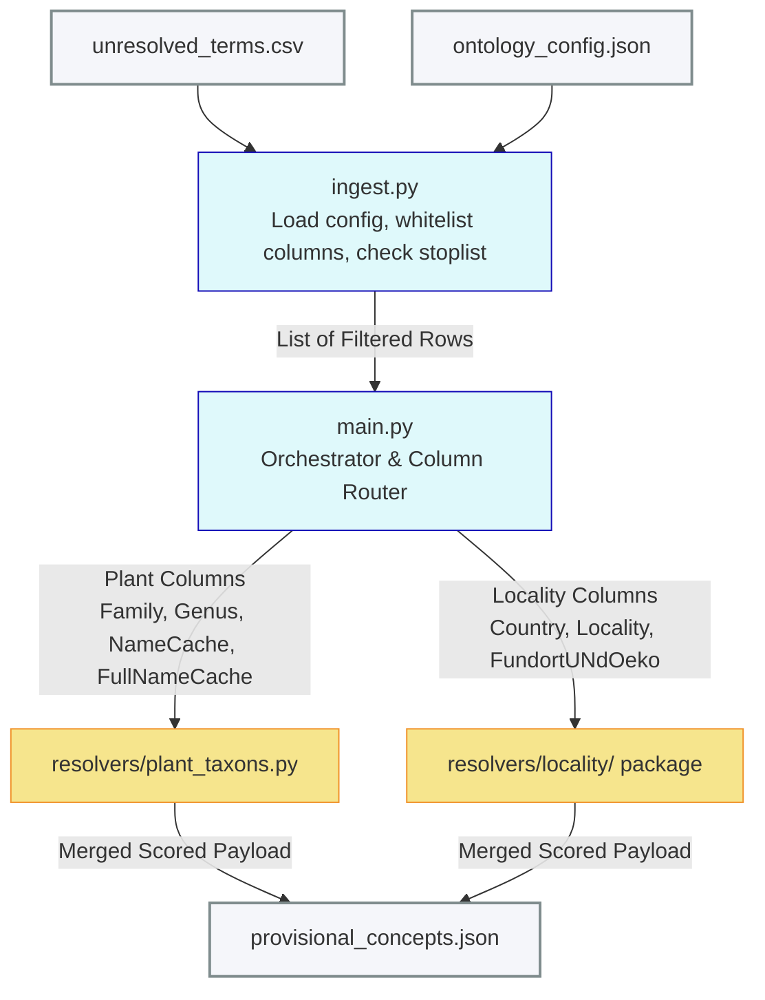
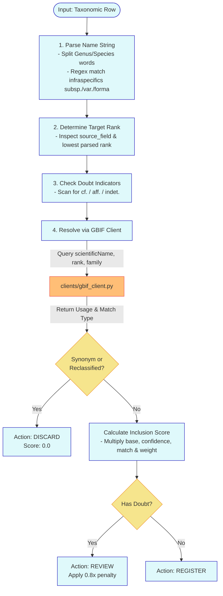
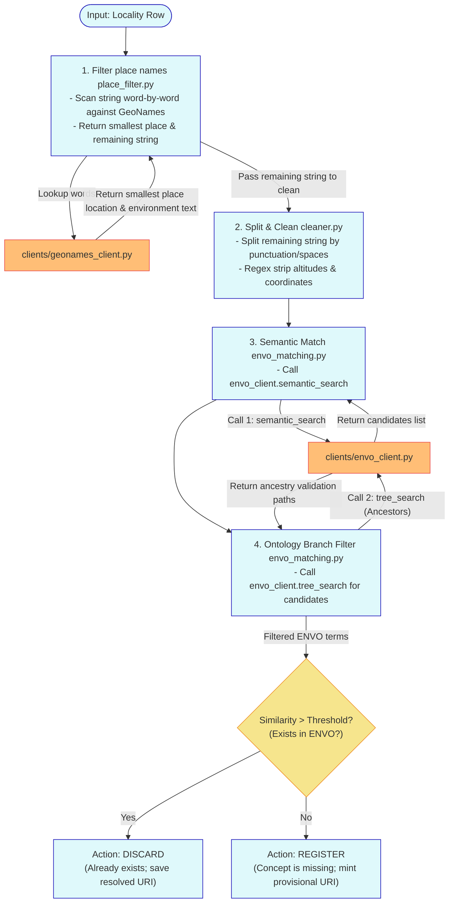

# WP5 - Provisional Concepts

**LARGELY GENERATED BY AI** - the spec is mine, but the README has been generated then corrected. It will be removed and a proper version will be put in the repo docs!

This directory contains the Python business logic for the **Provisional Concepts (WP5)** pipeline module.

## 1. Pipeline Overview

The module uses a decoupled architecture separating orchestration, ingestion, scientific resolvers, and API connection clients.



---

## 2. Directory Layout and File Descriptions

```text
bin/
├── main.py                       # CLI Orchestrator (reads CSV, directs routing, writes JSON)
├── ingest.py                     # CSV parser and stoplist/field whitelist filter
├── ontology_config.json          # Scoring configuration weights by column type (from WP2 Recommender)
│
├── clients/                      # API connections
│   ├── __init__.py
│   ├── gbif_client.py            # GBIF backbone match lookup
│   ├── geonames_client.py        # GeoNames API connection
│   └── envo_client.py            # OLS search & embedding search wrapper
│
└── resolvers/                    # scoring modules
    ├── __init__.py
    ├── plant_taxons.py           # Evaluates species, subvar, forma; computes taxon scores 
    └── locality/                 # Locality resolver package
        ├── __init__.py           # Package entrypoint and orchestrator
        ├── cleaner.py            # Splits segments and regex-cleans altitudes/coordinates
        ├── place_filter.py       # Queries GeoNames to filter out place names
        └── envo_matching.py      # Matches remaining segments against ENVO via OLS and handles decisions
```

---

## 3. Resolvers & Detailed Subflows

### A. Plant Taxon Resolver (`resolvers/plant_taxons.py`)
Responsible for confirming botanical names against the **GBIF Backbone taxonomy**.



Would be nice to refactor this into something slightly more structured and for the scores to be calculted instead of guessed.
- **Name Parsing**: Splits raw text fields into genus/species components and searches for infraspecific ranks using regular expression patterns (`subsp.`, `var.`, `forma`, etc.).
- **Doubt Flagging**: Detects speculative qualifiers (`cf.`, `aff.`, `indet.`). If present, the action changes from `REGISTER` to `REVIEW` with a `0.8x` penalty. **Specifically this is not nice!**
- **Backbone Mapping**: Resolves names via the GBIF API. Matches mapped as `synonym=True` or containing genus spelling variants/transfers are flagged as `DISCARD` so they can be mapped to the accepted name downstream.
- **Scoring**: Computes `base_score * gbif_confidence * ontology_match_weight * gbif_match_score` to classify terms.

---

### B. Locality Resolver Package (`resolvers/locality/`)
Responsible for extracting ecological environments and matching them to the **Environmental Ontology (ENVO)**.



- **Place name filter (`place_filter.py`)**: Checks the input string against GeoNames (word-by-word). Finds geopolitical names (countries, states, counties, cities), resolves them to identify the "smallest" place (e.g., returning `Neukölln` from `Germany, Berlin, Berlin, Neukölln`), and returns it along with the remaining string.
- **Cleaner (`cleaner.py`)**: splits the remaining string by comma/punctuation/whitespaces, and removes altitudes (e.g., `300m`, `alt. 1000 ft`) and coordinates via regex. -> This could be extended to use an LLM
- **ENVO Matcher (`envo_matching.py`)**: Coordinates the ENVO matching process. It requests semantic matches for the cleaned environmental text by querying `envo_client` twice (Semantic Search & Tree Search).
  - **Match Found (Similarity > Threshold)**: The concept already exists in ENVO. The action is set to **`DISCARD`** (meaning we do not mint a new provisional concept, but we still preserve the matched ENVO URI for metadata enrichment).
  - **No Match / Low Match (Similarity < Threshold)**: The concept is missing from ENVO. The action is set to **`REGISTER`** (we mint a new provisional URI and recommend adding it to ENVO).
- **ENVO Client (`envo_client.py`)**: Exposes network helper functions `semantic_search(text)` and `tree_search(term_id)` to connect with the external OLS API.

---

## 4. Running & Testing

### Running the Module standalone
Run the orchestrator directly with your virtual environment activated:
```bash
python modules/local/provisional_concepts/bin/main.py \
    --input results/annotation/unresolved_terms.csv \
    --output results/provisional_concepts.json
```

### Geonames local

The local GeoNames resolver automatically handles the downloading and unpacking of administrative region maps and country datasets (defaulting to Germany `DE` on first load).

If you want to pre-download or add additional countries, you can run the script directly from the repository root:

```bash
# Default: download Germany (DE) data
.venv/bin/python3 modules/local/provisional_concepts/bin/clients/local_geonames.py

# Download specific countries (e.g. Austria (AT) and Switzerland (CH))
.venv/bin/python3 modules/local/provisional_concepts/bin/clients/local_geonames.py AT CH
```
