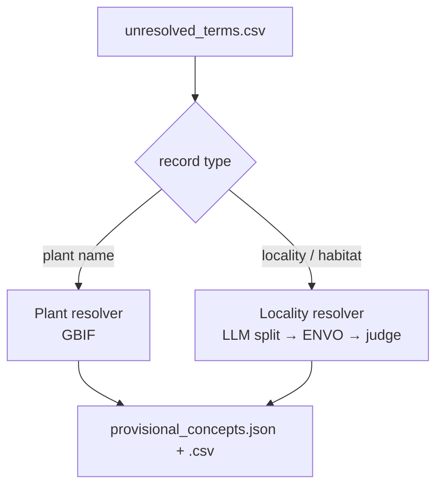

# Provisional Concepts (WP5)

This module resolves locality and habitat strings that were not matched earlier in the pipeline against the ENVO ontology. If ENVO does not contain a suitable match, it proposes a new provisional concept with an generated definition.

For running instructions, check the [USAGE guide](USAGE.md). For details on how individual components work and how they were evaluated, see the [documentation index](docs/README.md).

## What it does

Unresolved terms enter the pipeline as either plant names (taxa) or localities (habitat and geographic text). Each type is routed to a dedicated resolver, ending in one of three dispositions:

- ACCEPT: Matched to an existing ENVO term. The original German phrase is stored as a proposed synonym.
- REGISTER: Identified as a genuine habitat concept missing from ENVO, output with a newly generated definition.
- DISCARD: Contains only geographic place names without habitat description, or represents non-environmental text.

Plant names are processed through [GBIF](docs/components/plant-taxa.md). That path is functional but remained at an early version, as project priorities shifted toward the ENVO matcher. The locality path is handled by the [ENVO matcher](docs/components/envo-matcher.md).

If an input record includes an upstream Corine Land Cover (CLC) hint from WP3, it is passed to the final decision stage as supporting context.

## Inputs and outputs

The module reads `unresolved_terms.csv` from WP2 and produces `provisional_concepts.json` alongside `provisional_concepts.csv`. The JSON file contains the full structured payload for downstream processing, while the CSV provides a flat summary.

| Column | Description |
|---|---|
| `type` | `locality` or `taxon` |
| `original_term` | The raw unresolved input string |
| `proposed_action` | Action taken: ACCEPT, REGISTER, or DISCARD (or REVIEW for taxa) |
| `match_term`, `match_uri`, `match_confidence` | Matched ENVO term or GBIF usage details |
| `translated_term` | English translation of the habitat phrase |
| `definition`, `proposed_synonyms` | Generated definition for REGISTER or proposed synonyms for ACCEPT |
| `clc_code`, `clc_name` | Upstream Corine Land Cover hint |
| `explanation`, `details` | Explanation of the decision and parsing details |

The complete list of exported columns is defined in `export_csv.py`.

## Key scripts

- `main.py`: CLI orchestrator handling ingestion, resolution, export, and optional evaluation.
- `export_csv.py`: Converts the JSON result payload into CSV format.
- `evaluate.py`: Calculates precision, recall, and top-k metrics against ground truth data.
- `clients/local_geonames.py`: Downloads and prepares the local GeoNames dataset.

## Team and context

This module is part of the BGBM biodiversity pipeline for the FU Berlin Software Project (SS26), delivered to the Botanischer Garten und Botanisches Museum Berlin under the supervision of Prof. Dr. Adrian Paschke and client lead Ms. Karam.

Development contributions:
- Niso Sharifzoda: GeoNames resolver, evaluation pipeline, CSV exporter
- Dennis Gianelli: ENVO embedding retrieval and cross-encoder reranking
- Amina El Shorbagi: ENVO term cache and OLS client
- David Bauer: Plant taxa resolver, LLM splitter, pipeline integration
