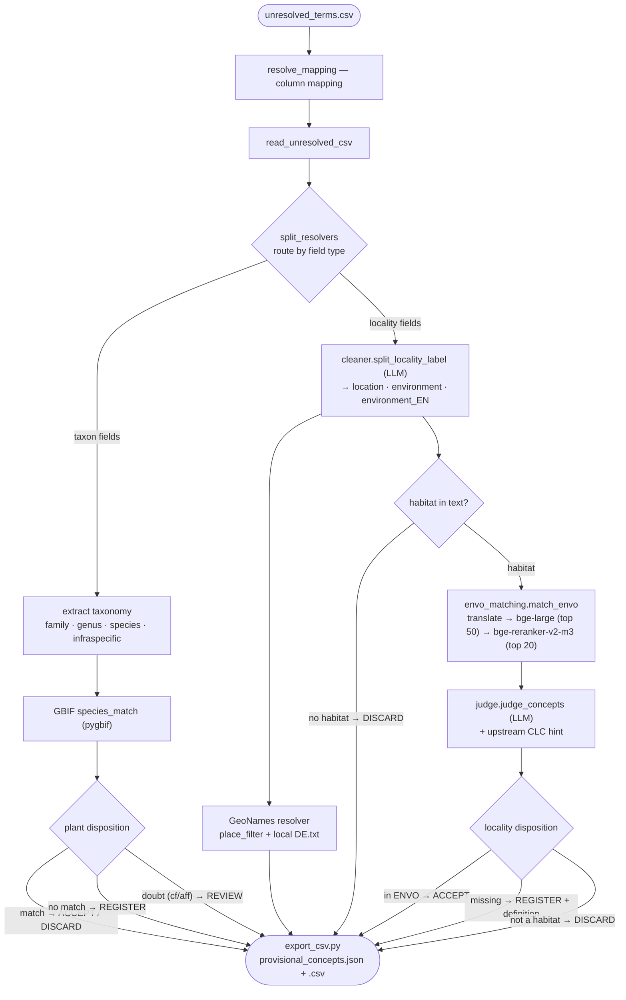

# WP5 Documentation

WP5 handles terms that the annotator in earlier pipeline stages could not resolve, specifically German free-text localities, habitat descriptions, and plant names. The module either matches them to an existing ontology concept or proposes them as new provisional concepts.

Locality strings are parsed by an LLM to separate geographic places from habitat descriptions. The habitat portion is matched against ENVO using dense vector retrieval, cross-encoder reranking, and an LLM judge. Plant names are matched against the GBIF backbone taxonomy.

Each record receives one of three dispositions: ACCEPT, REGISTER (with an accompanying definition), or DISCARD. The final output is exported as both a JSON payload and a flat CSV file. Most research and iterative development focused on the ENVO locality pipeline.

For a general overview of the module, see the [module README](../README.md). For step-by-step running instructions, refer to the [USAGE guide](../USAGE.md).

## How the pipeline fits together

## Component specifications

- [LLM splitter](components/llm-splitter.md): Parses raw locality text into structured geographic fields and habitat phrases.
- [GeoNames resolver](components/geonames-resolver.md): Offline place-name matching against a local German dump.
- [ENVO matcher](components/envo-matcher.md): Multi-stage habitat matching and provisional concept generation.
- [Plant taxa](components/plant-taxa.md): Taxonomic name resolution against GBIF.

## Research and evaluation

- [Evaluation and performance](research/evaluation.md): Quantitative benchmarks across components and datasets.
- [ENVO matcher study](research/envo-matcher-study.md): Experimental record covering models, pools, and retrieval techniques.
- [Decisions and lessons](research/decisions.md): Analysis of design choices, trade-offs, and engineering challenges.

## Project compliance

- [Requirements compliance](requirements.md): Status mapping against the original project specifications.
