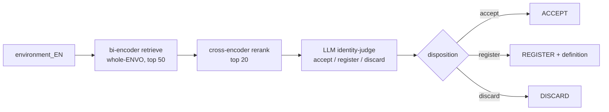

# ENVO Matcher

The ENVO matcher resolves free-text habitat descriptions (extracted from locality fields using the LLM splitter) against the Environment Ontology (ENVO). When an input phrase cannot be matched to an existing term, the system proposes it as a new provisional concept.

## Overview and role in the pipeline

This module handles the core habitat resolution logic for WP5. It takes clean habitat descriptions, retrieves candidate ENVO terms from a pre-built ontology cache using dense embeddings, reranks candidates with a cross-encoder model, and applies a confidence threshold along with an LLM judge to determine final disposition.

The terms matched against are loaded from a local cache (created by `envo_client.py`) containing terms from relevant ontology branches fetched via the EMBL-EBI Ontology Lookup Service (OLS) API.

## Resolution workflow

Matching runs through four sequential steps:

1. Translation: Input German habitat text is translated to English because ENVO is an English-language ontology.
2. Embedding retrieval: A bi-encoder model (`bge-large-en-v1.5`) embeds the query and computes similarity scores across all cached ENVO term embeddings, returning the top 50 candidates.
3. Reranking: A cross-encoder model (`bge-reranker-v2-m3`) reranks the top 20 candidates using full metadata (labels, synonyms, and descriptions), assigning calibrated confidence scores between 0.0 and 1.0.
4. Thresholding and LLM judgment: If the top reranking confidence score falls below 0.7, the match is marked as uncertain. The top candidates are evaluated by an LLM identity judge to confirm whether a candidate denotes the exact same concept (ACCEPT), a missing concept needing registration (REGISTER with definition), or non-habitat text (DISCARD).



## Why embedding retrieval was chosen over a pure LLM approach

The team designed the retrieval step to minimize direct LLM dependence while keeping the pipeline simple and traceable. The priority was generating accurate outputs where every step can be reliably audited.

| Property | Embedding approach | Pure LLM approach |
|---|---|---|
| Hallucinated terms | Every candidate is a verified ENVO term with a valid OBO ID | Can invent plausible but non-existent term names and URIs |
| Decision making | Confidence threshold caps the decision and avoids forcing a weak match | May struggle to abstain when no valid match exists |
| Auditability | Every match can be backtracked using bi-encoder and cross-encoder scores | LLM internal reasoning cannot be easily audited |
| Determinism | Identical input produces identical candidate rankings | Output can vary between runs |
| Scalability and performance | Locally executable with lightweight cross-encoder reranking | Incurs typical API latency and per-query token cost |

## Technical function reference

### `envo_client.py`

- `get_descendants(root_iri)`: Fetches all descendant terms of a specified ENVO root class from OLS.
- `semantic_search(text, rows=10)`: Performs raw OLS full-text search against ENVO (available as fallback).
- `simplify_term(term, root_iri)`: Reduces raw OLS JSON objects to essential fields (`label`, `iri`, `obo_id`, `description`, `synonyms`, `root_iri`).
- `build_envo_cache(cache_path)`: Iterates over specified root IRIs, deduplicates terms, and saves them to `envo_relevant_terms.json`.
- `load_envo_cache(cache_path)`: Loads the term cache from disk or builds it automatically if missing.
- `tree_search(term, cache_path)`: Performs exact substring lookups against cached labels and synonyms.

### `envo_matching.py`

- `translate_to_english(text)`: Translates German locality text to English via in-pass LLM translation or Google Translator with original text fallback.
- `build_envo_text(term)` and `build_rerank_text(term)`: Construct text representations for embedding and reranking. `build_envo_text` incorporates synonyms, while `build_rerank_text` includes term descriptions.
- `build_envo_embeddings(terms, cache_path)`: Computes bi-encoder embeddings for all cached ENVO terms and saves them to disk.
- `load_resources()`: Loads ENVO terms and embeddings into global memory on startup, generating the cache if missing.
- `embedding_search(query, top_k=RETRIEVE_K)`: Embeds the query and calculates cosine similarity scores across cached embeddings, returning top candidate terms with scores.
- `rerank(query, candidates)`: Scores candidates using the cross-encoder model and returns reranked matches with calibrated scores.
- `match_envo(clean_field, threshold=EXISTENCE_THRESHOLD)`: Main entry point orchestrating translation, embedding search, reranking, thresholding, and candidate formatting.

## Result payload structure

`match_envo` returns a structured dictionary:

```json
{
  "method": "embedding+rerank",
  "exists": true,
  "matches": [
    {
      "label": "sphagnum bog",
      "iri": "http://purl.obolibrary.org/obo/ENVO_01000240",
      "obo_id": "ENVO:01000240",
      "description": ["A bog that is dominated by mosses of the genus Sphagnum."],
      "synonyms": ["peat bog"],
      "root_iri": "http://purl.obolibrary.org/obo/ENVO_01000175",
      "score": 0.842,
      "rerank_score": 0.915
    }
  ],
  "top_score": 0.915,
  "query_en": "sphagnum bog"
}
```

If `exists` is `false`, `matches` is omitted and `top_score` indicates the highest score reached below the confidence threshold.

## Related documentation

- [ENVO matcher research study](../research/envo-matcher-study.md): Experimental evaluations across candidate pools and rerankers.
- [LLM splitter](llm-splitter.md): Provides translated habitat input strings.
- [Evaluation and performance](../research/evaluation.md): Quantitative benchmark results.
- [Decisions and lessons](../research/decisions.md): Architecture rationale and comparison tables.
